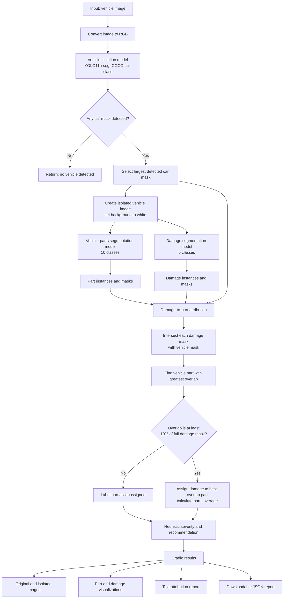

# System Architecture

This document describes the inference pipeline implemented in `app.py`.

## Architecture diagram

## Pipeline stages

1. **Input and preprocessing** — The uploaded image is converted to RGB.
2. **Vehicle isolation** — The COCO-pretrained YOLO11n-seg model is restricted to the car class (class ID 2). If multiple cars are detected, the largest mask is selected. Pixels outside that mask are set to white.
3. **Vehicle-part segmentation** — The fine-tuned parts model predicts vehicle-part instances on the isolated image.
4. **Damage segmentation** — The fine-tuned damage model independently predicts damage instances on the same isolated image.
5. **Damage-to-part attribution** — Each damage mask is intersected with the vehicle mask. The part with the largest overlap is selected when that overlap is at least 10% of the full damage-mask area; otherwise, the damage is marked `Unassigned`.
6. **Coverage and severity estimate** — For an assigned damage, part coverage is calculated as overlap pixels divided by the selected part-mask pixels. The application applies rule-based severity labels and repair/replace recommendations.
7. **Results** — The Gradio interface displays the original image, isolated vehicle, part and damage visualizations, a text report, and a downloadable JSON report.

## Model roles

| Model | Role | Training provenance |
|---|---|---|
| Vehicle model | Isolates the car using the COCO car class | Pretrained; not trained by the project author |
| Parts model | Segments 10 vehicle-part classes | Fine-tuned by the project author |
| Damage model | Segments 5 damage classes | Fine-tuned by the project author |

The parts and damage models are separate because they were trained for different segmentation label sets.

## Important limitations

- The largest detected car is selected; the application does not let the user choose among multiple detected cars.
- Damage-to-part assignment is based on mask overlap, not a learned attribution model.
- Severity and repair/replace recommendations are heuristic estimates, not validated automotive or insurance assessments.
- Model metrics are model-level test metrics and should not be described as end-to-end system accuracy.
- This diagram documents the current `app.py` implementation; it does not imply that the inference stages run in parallel.
